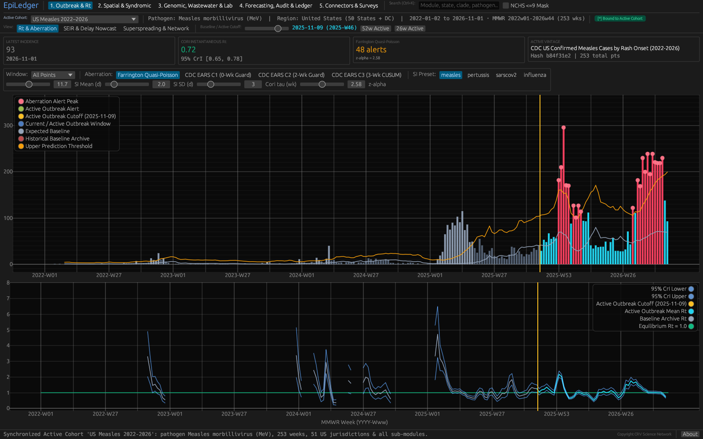

# EpiLedger (`epiledger-rs` v2.0.0) — Native Rust Public Health Informatics Workbench



Pure-Rust, local-first public health surveillance, differential-privacy governance, forecast evaluation, privacy-preserving clinical record linkage (`PPRL`), environmental biostatistics, sero-epidemiology, `CLSI M39` antimicrobial resistance, wastewater `SNV` deconvolution, superspreading network analytics, and phylodynamic genomics workbench.

Ships with **three execution interfaces** in a single `epiledger` binary:
1. **16-Tab Native `wgpu`/`egui` Desktop Workstation** (`epiledger` or `epiledger gui`)
2. **8-Screen Headless `ratatui` + `crossterm` SSH Terminal UI** (`epiledger tui`)
3. **Batch CLI (`39` subcommands)** + zero-JS HTML5/SVG Situation Report (`SitRep`) exporter

## Workspace Crate Architecture (5 Crates)

| Crate | Path | Key Capabilities |
| :--- | :--- | :--- |
| `epi-core` | `crates/epi-core` | `#![forbid(unsafe_code)]` core safety; CDC `MmwrWeek` calendar math, `SuppressionPolicy::NchsWonderLe9` (`<=9`) masking (`CellValue`), SNOMED-CT/ICD-10/LOINC enums, embedded CDC US Measles & State Pertussis baselines |
| `epi-store` | `crates/epi-store` | `#![forbid(unsafe_code)]` core safety; bundled SQLite WAL (`EpiStore`), CSPRNG-keyed HMAC-SHA256 Discrete Laplace ($\varepsilon$-DP) & Canonne–Kamath–Steinke Discrete Gaussian ($\rho$-zCDP) with $\rho = \varepsilon^2 / 2$ accounting and per-row `zcdp_delta` persistence, tamper-evident SHA-256 hash chain, and hash-blocked 512-bit Bloom PPRL |
| `epi-ingest` | `crates/epi-ingest` | `#![forbid(unsafe_code)]` core safety; CDC SODA (`NNDSS`, `NWSS`), CMU Delphi FluView, openFDA FAERS, WHO GHO OData, HL7 v2.5.1 ELR, deterministic NSSP ESSENCE `NegEx`, HL7 FHIR R4, GeoJSON, and pure-Rust SAS Transport v5 (`.XPT`) `IBM370` decoder |
| `epi-analytics` | `crates/epi-analytics` | `#![forbid(unsafe_code)]` core safety; Cori (2013) shifted triangular-tent $R_t$ + daily EM disaggregation, multi-jurisdiction DP $R_t$ & surge comparative risk digest (`JSON`/`CSV`), Farrington/EARS aberration detection, right-truncation delay nowcasting, scoped-parallel RK4 + Binomial tau-leaping SEIR/SEIRS (`reported <= true_weekly_infections`), $K=11$ WIS ensembles, Lloyd-Smith $k$ MLE, Freyja $L_1$ wastewater demixing, `CLSI M39` antibiograms, 3-source CRC, Nishiura cCFR, Gasparrini DLNM, EuroMOMO, Kulldorff spatial scan, NHANES survey variance, FAERS PRR/ROR/IC |
| `epi-app` | `crates/epi-app` | `#![deny(unsafe_code)]` binary crate (`#[allow(unsafe_code)]` strictly scoped to Win32 `AttachConsole`); 16-tab `egui`/`egui_plot` desktop app (responsive perceptual US cartogram, shaded 95% CrI $R_t$ bands, debounced SEIR sliders, lazy Tab 12 PPRL benchmark, multi-jurisdiction DP risk digest), 8-screen `ratatui` TUI, SitRep HTML/SVG export, and `40`-subcommand CLI |

## Controls & Keyboard Hotkeys (GUI)

| Shortcut / Control | Action | Scope / Notes |
| :--- | :--- | :--- |
| `Alt+1` – `Alt+5` | Switch to Domain Pillars 1–5 | Opens first sub-tab of selected pillar |
| `Ctrl+Tab` / `Ctrl+Shift+Tab` | Cycle forward / backward across all 16 sub-tabs | Wraps across all 5 pillars |
| `Ctrl+K` or `Ctrl+F` | Focus global `Search` bar (`Enter` jumps to match) | Global top bar |
| `F1` | Toggle About EpiLedger modal | Global |
| `Escape` | Close About modal, then clear global search | Global |
| `NCHS <=9 Mask` checkbox | Enforce `SuppressionPolicy::NchsWonderLe9` | Masks `1..=9` cases & rates across plots, cartogram tiles (`*` + hatching), tooltips, state inspector, and LLR table |
| SEIR / Nowcast Sliders | Tune delay, $R_0$, immunity, contact reduction, horizon | Debounced on `drag_stopped()` / `lost_focus()` |
| Cartogram Tile Click / Hover | Inspect jurisdiction & view NCHS-safe tooltip | Responsive 12×8 US state + DC grid with perceptual colorbar |

## Representative CLI Commands & Flags

| Command | Arguments / Flags | Description |
| :--- | :--- | :--- |
| `epiledger` / `gui` | `--screenshot <OUT.png> [--screenshot-view <1\|2\|3>]` | Launch 16-tab desktop GUI or capture offscreen GPU PNG |
| `tui` | `EPILEDGER_DB=<path>` env var | Launch 8-screen headless `ratatui` SSH terminal UI |
| `vintages` / `analyze` | `[vintage_id]` | List SQLite vintages; run Cori $R_t$ & Farrington GLM |
| `nowcast` / `seir-forecast` | `[vid] [delay_wk]` / `[vid] [weeks] [trajectories]` | Right-truncation nowcast & Binomial SEIR forecast |
| `backtest-wis` / `export-sitrep` | `[vid] [horizon] [origins]` / `[vid] [out.html] [mask]` | $K=11$ WIS ensemble & standalone HTML5/SVG SitRep |
| `dp-release` / `dp-risk-digest` | `[vid] [eps] [cap] [out.csv]` / `[campaign] [eps] [json] [csv]` | CSPRNG Discrete Laplace release & multi-jurisdiction DP $R_t$ + ICU surge comparative risk digest |
| `audit-verify` | `[limit]` | SHA-256 tamper-evident audit chain verification |
| `pprl-bench` / `pprl-link` | `[num_patients] [blocked\|cartesian]` / `[dice] [days]` | LSH + Birth-Year blocked PPRL & Fellegi–Sunter EM |
| `offspring-k` / `contact-network` | `[csv\|builtin] [all\|ztnb]` / `[csv\|builtin] [out.dot]` | Negative Binomial $k$ MLE & bipartite contact networks |
| `wastewater-demix` / `antibiogram` | `[snv.csv\|builtin] [log2\|sqrt]` / `[amr.csv\|builtin] [dedup\|raw]` | Freyja $L_1$ SNV deconvolution & CLSI M39 antibiograms |
| `fetch-nndss` / `fetch-nwss` / `fetch-delphi` / `fetch-faers` / `fetch-who` | Provider query arguments | Keyless live surveillance ingestion with SQLite cache |

Run `epiledger --help` for all 40 CLI subcommands.

## Build, Tests & Headless Validation

```bash
cargo test --workspace --release   # 64 tests passing across all 5 crates + headless validation
cargo run --release -p epi-app
cargo run --release -p epi-app -- tui
cargo test -p epi-analytics --test headless_validation -- --nocapture
```

Observed headless validation telemetry ([`validation/epiledger_validation_summary.json`](validation/epiledger_validation_summary.json)):
- **T1 (`t1_discrete_laplace_dp_cell_suppression_and_hash_chain_tamper_verification`)**: 253 weekly points (`cdc_measles_2022_2026_v1`), 90 NCHS-suppressed small cells, Discrete Laplace $\varepsilon = 0.75$ ($\alpha = 0.4724$, analytical RMSE $1.8421$, empirical MAE $0.9723$, empirical RMSE $1.6078$), budget cap `2.0` enforcement, and SHA-256 audit tamper detection at `seq_no = 1`.
- **T2 (`t2_bloom_pprl_blocking_and_essence_negex_classification`)**: 80 perturbed records across 40 entities, $91.77\%$ pair pruning via hash blocking ($260$ vs $3{,}160$ Cartesian pairs, $P = R = F_1 = 1.0$), and $100\%$ NSSP ESSENCE `NegEx` negation specificity across 8 negative controls ($37$ negations blocked).
- **T3 (`t3_cori_rt_and_freyja_wastewater_deconvolution`)**: 129 valid Measles $R_t$ weeks (peak mean $4.72$, terminal $0.72$), daily-EM disaggregation on 8-week respiratory ILI, and Freyja $L_1$ wastewater deconvolution across 10 samples (`JN.1`, `KP.2`, `KP.3.1.1`, `XEC`) with weighted $L_1$ loss `0.00765` and `0.0` simplex deviation.

## Documentation & Preprint

- [`docs/USER_GUIDE.md`](docs/USER_GUIDE.md) — Complete 5-pillar / 16-tab manual, keyboard navigation, NCHS masking workflows, and CLI recipes.
- [`docs/SCIENTIFIC_METHODS.md`](docs/SCIENTIFIC_METHODS.md) — Mathematical reference for CSPRNG DP / zCDP composition ($\rho = \varepsilon^2 / 2$), Cori (2013) triangular SI integration, Binomial SEIR reporting, and statistical models.
- [`docs/epiledger_v2_user_guide.pdf`](docs/epiledger_v2_user_guide.pdf) — Printable v2.0 PDF guide.
- **CRV Science Apps Hub**: <https://crvscience.com/apps>
- **Preprint (`APP-PREPRINT-06`)**: [EpiLedger: Differentially Private Public Health Surveillance, Bloom-Filter Record Linkage, and Renewal Rt Estimation](https://crvscience.com/apps/preprints/epiledger-differential-privacy-epidemiology)
- **Concept DOI**: [`10.5281/zenodo.24222382`](https://doi.org/10.5281/zenodo.24222382)

See [`CITATION.cff`](CITATION.cff) for machine-readable citation metadata.
